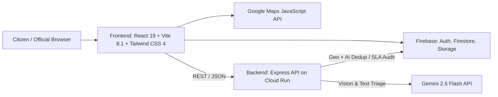
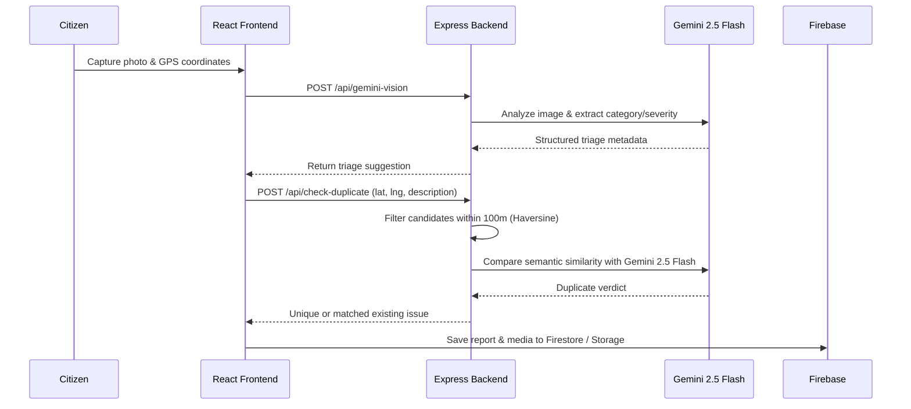

# CivicAI — AI-Powered Civic Issue Resolution Platform

**Bridging citizens and municipal authorities with Gemini Vision triage, 100m geospatial duplicate detection, Google Maps, Firebase, and Cloud Run.**

- **Frontend:** React 19 · Vite 8.1 · Tailwind CSS 4
- **Backend:** Express (`backend/server.js`) · Gemini 2.5 Flash
- **Cloud & Data:** Google Maps JavaScript API · Firebase (Auth, Firestore, Storage) · Google Cloud Run
- **License:** [MIT](LICENSE)

---

## Problem Statement & Solution

### The Problem
Municipal issue reporting often suffers from three bottlenecks:
1. **Manual Triage Overhead:** Citizens struggle to categorize civic issues (potholes, broken streetlights, water leaks, garbage accumulation) or identify the responsible department.
2. **Duplicate Reports:** Multiple residents report the same nearby issue, flooding municipal queues with redundant tickets.
3. **Silent SLA Breaches:** Open issues frequently stall without automated monitoring or escalation.

### The Solution
**CivicAI** provides a full-stack civic tech platform where:
- Citizens upload a photo and location; **Gemini 2.5 Flash** automatically classifies the issue, assesses severity, and drafts structured metadata.
- A **100-metre Haversine + Gemini 2.5 Flash** pipeline checks nearby open reports to prevent duplicate tickets before submission.
- Interactive **Google Maps** views visualize live civic issues across neighbourhoods.
- An **SLA Audit** endpoint flags open issues exceeding the **7-day** threshold for escalation.

---

## Architecture

### System Architecture



### Issue Reporting & Triage Workflow



---

## Tech Stack & Implementation Details

### Frontend (`frontend/`)
- **Framework & Build:** React 19 + Vite 8.1 + Tailwind CSS 4
- **Maps Integration:** Google Maps JavaScript API (`VITE_GOOGLE_MAPS_API_KEY`) for geospatial issue plotting and location selection.
- **Firebase Integration (`frontend/src/firebase.js`):** Initializes Firebase Auth (`auth`, `googleProvider`), Cloud Firestore (`db`), and Cloud Storage (`storage`) using `VITE_FIREBASE_*` environment variables.
- **Containerization:** `frontend/Dockerfile` builds the Vite bundle and serves static assets via Nginx (`frontend/nginx.conf`) for Cloud Run.

> **Known Implementation Note:** `frontend/src/App.jsx` imports Firestore/SLA helper functions from `./firebase` that are not yet exported in `frontend/src/firebase.js`. See [Testing & Linting](#testing--linting) before running a production build.

### Backend (`backend/server.js`)
Express API server exposing three core endpoints:
- `/api/gemini-vision` — Accepts an issue image and returns AI-generated category, severity, and summary using Gemini Vision.
- `/api/check-duplicate` — Performs a two-stage duplicate check:
  1. **Geospatial filter:** Computes Haversine distance to find existing open issues within **100 metres**.
  2. **Semantic verification:** Uses **Gemini 2.5 Flash** to determine whether the new report describes the same underlying issue.
- `/api/sla-audit` — Audits open issues and identifies tickets that have remained unresolved for **7 days** or longer.
- **Containerization:** `backend/Dockerfile` packages the Express server for serverless deployment on Google Cloud Run.

---

## Local Setup & Environment Variables

### 1. Clone the Repository
```bash
git clone https://github.com/23H51A62B9/Civic_AI
cd Civic_AI
```

### 2. Frontend Setup
Copy the example environment file and fill in your Firebase and Google Maps credentials:
```bash
cd frontend
cp .env.example .env
npm ci
npm run dev
```

Required variables in `frontend/.env` (see `frontend/.env.example`):
- `VITE_FIREBASE_API_KEY`
- `VITE_FIREBASE_AUTH_DOMAIN`
- `VITE_FIREBASE_PROJECT_ID`
- `VITE_FIREBASE_STORAGE_BUCKET`
- `VITE_FIREBASE_MESSAGING_SENDER_ID`
- `VITE_FIREBASE_APP_ID`
- `VITE_GOOGLE_MAPS_API_KEY`

### 3. Backend Setup
Copy the backend example environment file and configure your Gemini and Firebase keys:
```bash
cd backend
cp .env.example .env
npm ci
node server.js
```

Required variables in `backend/.env` (see `backend/.env.example`):
- `VITE_GEMINI_API_KEY`
- `VITE_FIREBASE_*` configuration values

---

## Testing & Linting

CI runs automatically on pushes and pull requests to `main` via `.github/workflows/ci.yml`:

### Frontend
```bash
cd frontend
npm ci
npx oxlint
npm run build
```

### Backend
```bash
cd backend
npm ci
node --check server.js
```

---

## Deployment

### Google Cloud Run (Backend & Frontend Containers)
Both `backend/Dockerfile` and `frontend/Dockerfile` are configured for Cloud Run:

```bash
# Deploy Backend
gcloud run deploy civic-ai-backend \
  --source ./backend \
  --region us-central1 \
  --allow-unauthenticated

# Deploy Frontend
gcloud run deploy civic-ai-frontend \
  --source ./frontend \
  --region us-central1 \
  --allow-unauthenticated
```

### Firebase Hosting (Alternative Frontend Deployment)
```bash
cd frontend
npm run build
firebase deploy --only hosting
```

---

## License

This project is licensed under the MIT License — see the [LICENSE](LICENSE) file for details.
